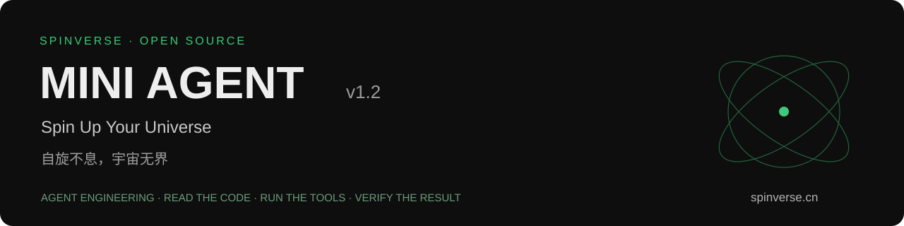
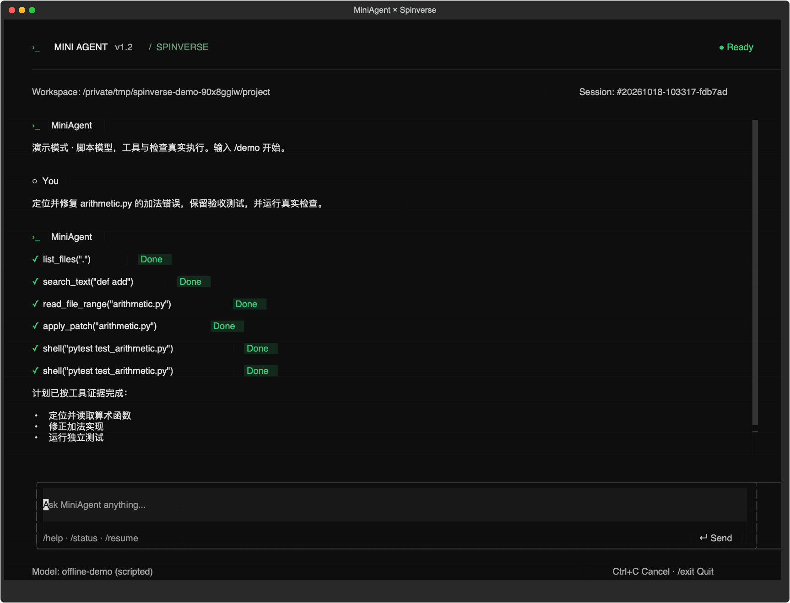

<div align="center">


### Read the code. Run the tools. Verify the result.

[中文](README.md) · [Community](COMMUNITY.md) · [Architecture](docs/ARCHITECTURE.md) · [Contribute](CONTRIBUTING.md)
</div>

MiniAgent v1.2 is a hands-on Python coding-agent runtime with a fullscreen terminal UI, linear plans, structured tools, permission checks, repository search, hash-checked patches, real verification, and recoverable sessions.

A **MiniAgent × Spinverse** open-source engineering practice. We care about making AI run, connecting it to real work, and creating measurable value.



## Quick start

macOS or Linux, Python 3.12+:

```bash
git clone https://github.com/zypher2424/spinverse-miniagent.git
cd spinverse-miniagent
python3 -m venv .venv
.venv/bin/python -m pip install -r requirements.txt
./miniagent --demo
```

Type `/demo`, then approve the patch and checks. No API key is needed. The demo uses an explicitly labeled scripted model; file discovery, search, patching, pytest, and persistence are real.

```bash
./miniagent --demo --yes --task "Fix the addition function and run its independent check"
```

For real tasks, copy `.env.example` to `.env` and provide your own `OPENAI_BASE_URL`, `OPENAI_API_KEY`, and `MODEL_NAME`. The provider must support Chat Completions and tool calling.

```bash
./miniagent --workspace /path/to/project
./miniagent --workspace /path/to/project --check tests/test_feature.py --task "Fix this module without changing the acceptance test"
```

## What is implemented

- A fullscreen Textual interface with actual tool status, fixed input, permission dialogs, cancellation, and session switching.
- Nine structured tools, validation before permission, and rechecking before execution.
- Linear plans backed by tool evidence, bounded correction, and explicit unfinished states.
- File discovery, literal search with line numbers, range reads, and single-file patches requiring a matching full-file SHA-256 and one unique old-text match.
- Independent pytest acceptance, recorded stdout/stderr/returncode, and protected acceptance-file hashes.
- Atomic checkpoints, action journals, session locks, and recovery that pauses on unknown outcomes.
- Whole-turn context trimming with the original task preserved, plus JSONL automation output.

Long-term memory, skills, MCP, subagents, and OS-level isolation are future work.

## Commands

`/help`, `/status`, `/plan`, `/actions`, `/history`, `/sessions`, `/resume ID`, `/retry`, `/resolve ID evidence`, `/new`, `/community`, `/exit`.

Enter sends. Ctrl+C cancels. Click a tool row to inspect its actual result. `--no-tui` selects line-oriented output; `--task` performs one task and exits; `--json` emits JSONL events.

```bash
.venv/bin/python -m pytest tests -q
python3 scripts/check_public_files.py
```

The current suite has 110 tests. The CI badge on the Chinese README links to actual GitHub Actions results. Shell restrictions are not an OS sandbox, checkpoints do not provide exactly-once side effects, and token counts are estimates. An in-flight synchronous network request must return or time out before cancellation finishes.

## Spinverse

**Spin Up Your Universe.**<br>
**自旋不息，宇宙无界。**

A community for AI engineers, product builders, entrepreneurs, researchers, and people exploring the boundaries of AI. We share deployment lessons, agent engineering, tools and workflows, research, open-source projects, and opportunities to build together.

Website: **[spinverse.cn](https://spinverse.cn/)**<br>
Collaboration / community contact: **TC_bjtu**<br>
Community slogan: **Spin Your Intelligence.**

[Community](COMMUNITY.md) · [Contributing](CONTRIBUTING.md) · [MIT License](LICENSE)
