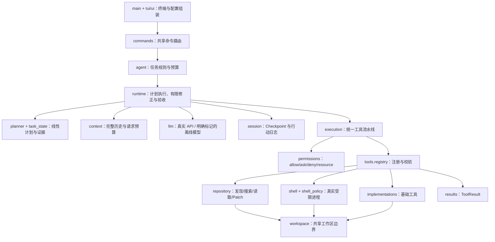

# 架构与执行契约

MiniAgent 将界面、任务策略、循环机制和工具实现分开。TUI 与逐行 CLI 使用同一命令路由和后端。



## 工具执行

```text
Parse → Validate(参数+资源) → Prepare(路径、argv、Diff)
      → 记录 prepared → Permission → 记录 started
      → Recheck+Execute → 记录 completed(ToolResult)
      → assistant/tool 配对回填 → Checkpoint
```

`ToolResult(status, message, data, error_code)` 的 status 为 success / error / denied / timeout。程序读取字段，不搜索“成功”“错误”等关键词。

未知工具默认拒绝；无效参数不询问权限；批准不能绕过硬路径策略。Shell 采用结构化 argv、固定 cwd、环境白名单、15 秒超时、每路输出最多 2000 字符、进程组清理。

## 计划与验收

计划包含 1–6 个 read/edit/check 步骤。步骤的 done 需要对应工具证据；修改后必须有真实检查。`--check` 指定独立 pytest 验收文件，失败、超时或文件哈希变化不能报告完成。

Verifier 检查步骤类型、涉及文件和命令结果，不能自动证明任意自然语言条件。模型自己的“测试通过”不构成外部证据。

## 文件定位与 Patch

搜索是字面量匹配，返回相对路径、一基行号和片段。扫描最多 1000 个可访问文件；范围、输出和单文件大小均有限制。隐藏路径、依赖目录、越界和符号链接逃逸不开放。

分段读取返回完整文件 SHA-256；Patch 要求该哈希仍相同，old_text 非空且只匹配一处。确认前展示 Diff，执行前重新检查，单文件原子替换。多文件不是事务，最后比较到替换间仍有并发竞态。

## 会话与取消

JSON Checkpoint 保存会话、工作区、消息、计划和行动记录，不保存密钥。记录采用临时文件、fsync 和原子替换，文件权限 0600，同一会话使用进程锁。

每批调用先记录 inflight，再执行。恢复使用完成结果补齐消息配对；没有 started 的行动标记未执行；started 没有结果则暂停核对，不自动重放。损坏记录保留并拒绝加载，日志失败停止继续修改。配置/代码指纹变化不静默恢复。

同步 Agent 在单个后台线程执行，通过 Queue 传递 UI 事件。Ctrl+C 阻止新工具调用、终止 Shell 进程组并保留记录。同步模型请求不能强行中断线程，界面等待本次请求返回或超时。

## 明确的边界

命令限制不是 OS 沙箱。Session 不保证恰好执行一次。Context token 是估计值；当前任务过大时明确停止；模型回复按完整响应显示。Memory、MCP、Skills、子代理和多任务并发没有在本版实现。
